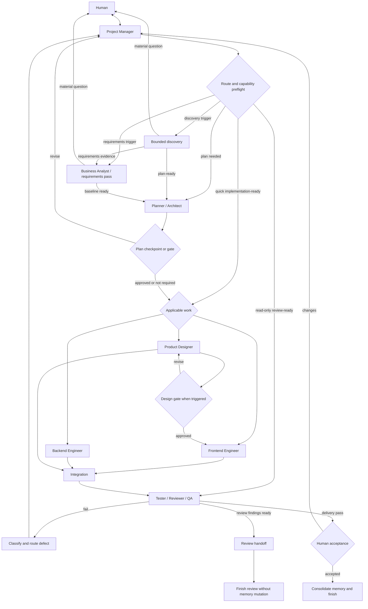

# Workflow Graph

This is the only canonical delivery graph and transition policy. `STATE.json` is the machine-readable state authority. `WORKFLOW.md` records the human-readable run contract and checkpoint evidence without copying this graph.

## Canonical graph

The Business Analyst pass runs inside `INTAKE` or `PLAN` and adds no state or gate. Inactive roles and passes are `N/A`; do not create work to exercise every role.

## Optional run envelopes

A task graph ([graph-engineering.md](graph-engineering.md)), concurrent writers ([execution-isolation.md](execution-isolation.md)), a loop ([loop-engineering.md](loop-engineering.md)) and their local ledgers ([graph runtime](graph-runtime.md), [loop runtime](loop-runtime.md)) are optional run-scoped contracts read only on their route trigger. None replaces `STATE.json`/`WORKFLOW.md` authority or Project Manager ownership of merge, integration, cleanup and gates.

## States and legal transitions

Allowed states are `INTAKE`, `DISCOVERY`, `PLAN`, `WAITING_PLAN`, `DESIGN`, `WAITING_DESIGN`, `BUILD`, `INTEGRATE`, `VERIFY`, `REWORK`, `WAITING_DECISION`, `WAITING_ACCEPTANCE`, `DONE`, and `BLOCKED`.

| From | Allowed next states |
|---|---|
| INTAKE | DISCOVERY, PLAN, BUILD, VERIFY, WAITING_DECISION, BLOCKED |
| DISCOVERY | DISCOVERY, PLAN, WAITING_DECISION, BLOCKED |
| PLAN | WAITING_PLAN, DESIGN, BUILD, VERIFY, WAITING_DECISION |
| WAITING_PLAN | PLAN, DESIGN, BUILD, BLOCKED |
| DESIGN | WAITING_DESIGN, BUILD, WAITING_DECISION |
| WAITING_DESIGN | DESIGN, BUILD, BLOCKED |
| BUILD | INTEGRATE, VERIFY, REWORK, WAITING_DECISION, BLOCKED |
| INTEGRATE | VERIFY, REWORK, BLOCKED |
| VERIFY | REWORK, WAITING_ACCEPTANCE, DONE (read-only review only), BLOCKED |
| REWORK | DISCOVERY, PLAN, DESIGN, BUILD, INTEGRATE, VERIFY, WAITING_DECISION, BLOCKED |
| WAITING_DECISION | DISCOVERY, PLAN, DESIGN, BUILD, VERIFY, BLOCKED |
| WAITING_ACCEPTANCE | REWORK, DONE, BLOCKED |
| BLOCKED | DISCOVERY, PLAN, DESIGN, BUILD, VERIFY, WAITING_DECISION |
| DONE | INTAKE |

Reject any other transition. A resume must restore exactly one `next_action`; if more than one action appears active, normalize at a human checkpoint.

`VERIFY -> DONE` is legal only for an explicit read-only review after its findings handoff. It performs no Acceptance Gate, implementation, stateful external action, or durable-memory consolidation. Delivery runs must use `VERIFY -> WAITING_ACCEPTANCE -> DONE`.

## Role contracts

| Role | Responsibility | Default boundary |
|---|---|---|
| Project Manager | Scope, routing, state, ownership, gates, integration, memory, handoff | Sole shared-state writer |
| Business Analyst (conditional pass) | Business outcome, actors, scope, rules, assumptions/questions, acceptance behavior, and shared vocabulary | Read-only; returns a requirement baseline and never invents stakeholder intent |
| Planner / Architect | System map, contracts, tasks, dependencies, rollout, measurable DoD | Planning artifacts within authorized scope; material unresolved choices go to the human |
| Researcher | Repository and external evidence, provenance, injection screening, unknowns | Read-only |
| Product Designer | User outcome, flows, hierarchy, states, tokens, accessibility, motion and reference contract | Approved design scope |
| Frontend Engineer | Client behavior, accessibility, responsive UI, data integration, frontend tests and budgets | Assigned client files |
| Backend Engineer | APIs, domain logic, data, validation, authorization, concurrency, observability and tests | Assigned server/data files |
| Tester / Reviewer / QA | Acceptance matrix, negative/boundary cases, final diff, regression and risk verification | Read-only; isolated when claimed independent |

Roles are contracts, not processes. Map them to isolated agents, sequential isolated sessions, or labeled same-agent passes using [capability-contract.md](capability-contract.md). A same-context pass can verify work but is never called independent.

## Role packet and ownership

Create a packet file from `assets/templates/ROLE-PACKET.md` only for a pass that runs in a separate context (child, parallel or cross-model). A same-agent pass records the template's contract fields as one `WORKFLOW.md` row. Forward only verified memory IDs, never raw retrieval dumps.

The Project Manager serializes overlapping file ownership. Frontend and backend run in parallel only after their interface contract is stable. Designer does not silently rewrite an approved direction. QA does not repair production code during its verification pass. A role may challenge inconsistent input but never silently changes another role's contract.

## Failure routing

Classify before retrying: requirement, discovery, plan/contract, design contract, implementation, test expectation, environment/capability, performance budget, or scale evidence. Preserve the same workload and threshold when repairing performance failures. Never label unavailable evidence as a pass.

The same blocker surviving three evidence-based attempts moves to `BLOCKED` or `WAITING_DECISION` by a legal edge: from `PLAN` or `DESIGN` that is `WAITING_DECISION`; from other states go through `REWORK` first when there is no direct edge. Record attempted fixes and ask the human rather than retrying blindly.

## Checkpoint writes

The Project Manager updates `STATE.json` and the current workflow only at intake, plan/gate, integration, verification, blocker, and completion. Use optimistic memory revisions from [memory-loop.md](memory-loop.md). Role agents return structured packets and do not concurrently edit `.harness/`.
